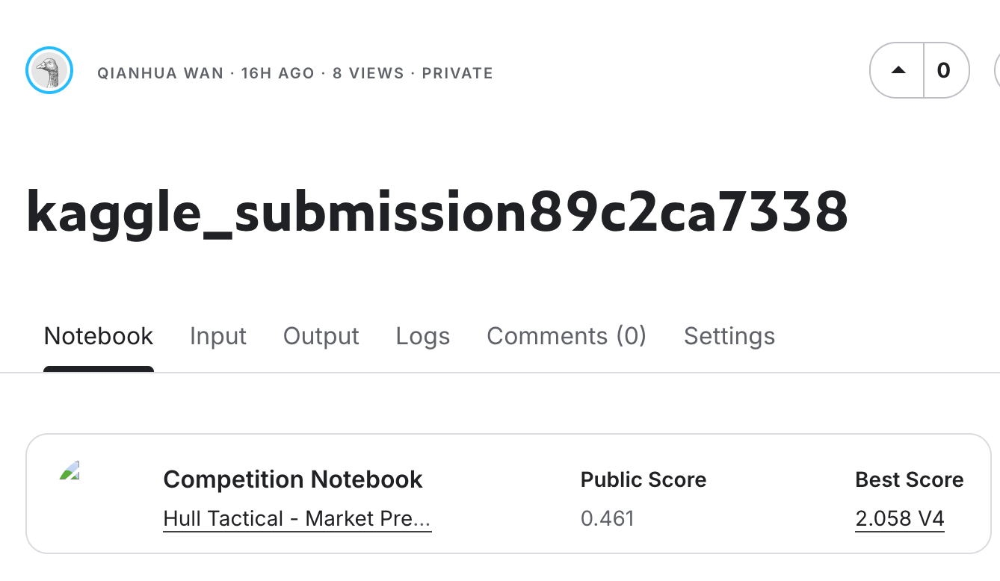

# Hull Tactical Market Prediction

DDA3020 course project exploring a stacking ensemble for the Kaggle **Hull Tactical - Market Prediction** competition. The supplied implementation trains Ridge, LightGBM, and XGBoost regressors, combines their predictions with a Ridge meta-learner, and maps predicted returns to exposure in `[0, 2]`.

This repository packages the original submission with a portable working notebook, a tested Python environment, and reproduction notes. **Competition data and trained models were not included in the source archive.** The historical screenshot shows a public score of **0.461**; this result has not been independently reproduced.



## Repository layout

```text
notebooks/
  kaggle_submission.ipynb           Working notebook: local paths and runtime fixes
  original/kaggle_submission.ipynb  Unmodified historical notebook
scripts/
  run_notebook.py                   Execute the working notebook on your own CSVs
  smoke_test.py                     End-to-end check using temporary synthetic data
  validate_repository.py            Notebook syntax and repository hygiene checks
tests/test_notebook_functions.py    Missing-data, feature-alignment and weight checks
docs/
  submission.pdf                   Original report with student IDs redacted
  assets/public_score.png           Unmodified historical score screenshot
  REPRODUCIBILITY.md                Execution, Kaggle and environment details
  KNOWN_LIMITATIONS.md              Modeling and validation caveats
  ORGANIZATION.md                   Archive inventory and change record
  VALIDATION.md                    Recorded verification and its boundaries
data/                              Place privately obtained competition CSVs here
artifacts/                         Generated CSVs and executed notebooks (ignored)
requirements.in                    Direct dependency ranges
requirements.txt                   Resolved dependencies tested with Python 3.12
```

## Local setup

Use **Python 3.12**. From the repository root:

```bash
python3.12 -m venv .venv
source .venv/bin/activate
python -m pip install -r requirements.txt
python -m ipykernel install --prefix .venv --name hull-tactical --display-name "Hull Tactical (Python 3.12)"
```

On Windows, activate with `.venv\Scripts\activate` and use the installed Python 3.12 executable. On macOS, a LightGBM or XGBoost import error mentioning `libomp` requires installing OpenMP with `brew install libomp`; see [reproduction notes](docs/REPRODUCIBILITY.md). Verification used macOS arm64; other platforms have not been tested.

### Check the installation without competition data

```bash
python scripts/validate_repository.py
python -m unittest discover -s tests -v
python scripts/smoke_test.py
```

The smoke test trains all three base models and the meta-learner on synthetic data, runs inference, and checks the generated CSV. It verifies execution only and does not measure competition performance.

### Run with your own authorized data

Obtain the CSVs from the [competition data page](https://www.kaggle.com/competitions/hull-tactical-market-prediction/data) under the applicable access conditions. Place them at `data/train.csv` and `data/test.csv`, ordered chronologically. No API key is required to execute the notebook once the data is available locally.

```bash
python scripts/run_notebook.py --train data/train.csv --test data/test.csv
```

Outputs are `artifacts/submission.csv` and `artifacts/kaggle_submission.executed.ipynb`. You can instead open `notebooks/kaggle_submission.ipynb` in JupyterLab using the environment above. The first configuration cell accepts paths through environment variables; see [REPRODUCIBILITY.md](docs/REPRODUCIBILITY.md).

## Method and evidence

The notebook implements iterative missing-value imputation, variance and correlation filtering, target-aware feature selection, Isolation Forest anomaly indicators, conditional winsorization, an 80/20 sequential split, and a Ridge + LightGBM + XGBoost stack. A separate sigmoid mapping is used by the optional Kaggle inference callback.

The [course report](docs/submission.pdf) discusses additional standalone LightGBM and Random Forest experiments. Their training scripts, raw results, original environment, and data were absent from the archive. The uploaded notebook has no saved execution outputs.

**The working notebook retains the historical research design. Its preprocessing and feature selection happen before the split, its meta-learner uses in-sample base predictions, and target-derived fields may be used as features.** An 80/20 sequential split therefore does not establish leakage-free validation. Read [KNOWN_LIMITATIONS.md](docs/KNOWN_LIMITATIONS.md) before interpreting any metric. This is a course project, not a validated trading system.

For Kaggle, the competition-provided evaluation API is required; the local CSV is a debugging artifact rather than a verified competition submission. Enable the inference server only in the Kaggle environment as described in the reproduction notes.

## Credits and usage

Project authors credited in the report: Luo TianCheng, Wan Qianhua, Hng Cherng Khai, Chan Kee Qing, and Chen Yike. The repository report removes their student identifiers while preserving the research content. No software license was supplied, so none has been assigned on the authors' behalf. Competition data remains subject to its source terms and is excluded from Git.
